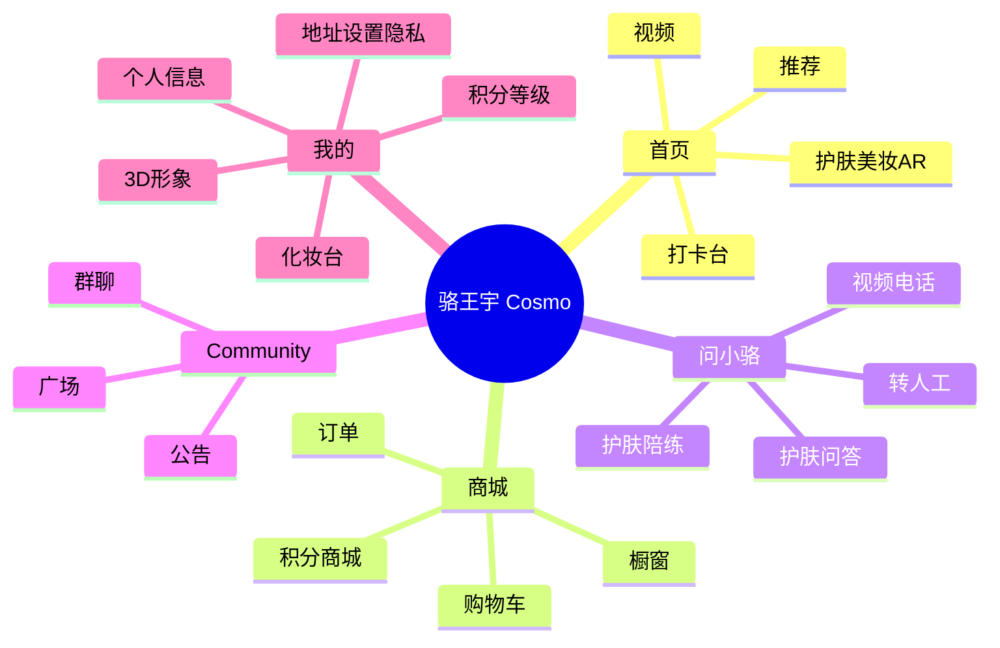

# 骆王宇 Cosmo · 预想模块功能思维导图

> **预想模块（尚未实现）**  
> 仓库路径：[`设计文档/工程文档/1126`](./)  
> 可交互 HTML：[`cosmo-feature-mindmap.html`](./cosmo-feature-mindmap.html)  
> 可交互 Canvas：[Cosmo 功能思维导图](https://cursor.com/canvas/store-c5e1734d-032a-4ab6-ac57-363d49c53079/cef464bc-0882-4069-ad41-b7c3e189cccd)

**标注说明**

- 〔核心〕用户给定的结构节点，须保留
- 〔发散〕在核心之上补充的、可落地的产品能力点

---

## 总览

---

## 1. 首页 〔核心〕

首页是内容与习惯养成的入口：推荐信息流承载发现，视频承载 IP 内容，护肤/美妆（含 AR）承载转化与体验，打卡台承载留存。

### 1.1 推荐 〔核心〕

- 〔核心〕信息流算法（兴趣 / 互动 / 时效加权）
- 〔核心〕个性化（肤质画像、关注达人、浏览与购买冷启动）
- 〔核心〕运营位（Banner、专题卡、开屏/弹窗联动位）
- 〔核心〕下拉刷新
- 〔发散〕首次启动兴趣标签选择器（护肤 / 彩妆 / 直播偏好）
- 〔发散〕负反馈：「不感兴趣」「减少此类内容」写入排序特征
- 〔发散〕双列瀑布流 ↔ 单列沉浸视频流一键切换
- 〔发散〕顶部轻量公告条（系统维护、大促倒计时）
- 〔发散〕内容卡类型：图文、短视频、直播预告、商品种草、打卡挑战

### 1.2 视频 〔核心〕

- 〔核心〕最新一期显示在首页（封面 + 标题 + 开播/更新时间）
- 〔核心〕往期入口（节目列表 / 分页或无限滚动）
- 〔核心〕直播进行中时推送到首页（角标「直播中」、一键进房）
- 〔核心〕录播回看
- 〔发散〕开播预约提醒（系统推送 + 可选写入系统日历）
- 〔发散〕弹幕、点赞、礼物 / 打赏互动
- 〔发散〕系列合集与节目单（按季 / 主题归档）
- 〔发散〕观看进度续播（跨端同步到「我的」足迹）
- 〔发散〕分享：海报生成、短链、微信/社媒卡片
- 〔发散〕清晰度、倍速、静音自动播策略
- 〔发散〕章节打点（跳转到「妆前 / 产品演示」等段落）
- 〔发散〕关联商品挂载条（点击跳转商城 SKU / 达人橱窗）
- 〔发散〕直播结束后自动生成录播入口与精彩切片

### 1.3 护肤 / 美妆（+AR） 〔核心〕

- 〔核心〕护肤 / 美妆频道入口（含 AR 能力入口）
- 〔发散〕AR 试妆：唇彩、眼影、底妆实时预览；保存前后对比图
- 〔发散〕肤质检测：拍照生成干油 / 毛孔 / 色沉等分项报告
- 〔发散〕按检测结果推荐产品（成分匹配 + 库存可售过滤）
- 〔发散〕教程视频 ↔ 商城 SKU 双向联动（「同款一键加购」）
- 〔发散〕妆容模板收藏、套用、与好友对比分享
- 〔发散〕成分敏感提示（对照「护肤档案」过敏原）
- 〔发散〕「今日妆容」快捷入口，同步到 3D 个人形象妆面

### 1.4 打卡台 〔核心〕

- 〔核心〕打卡台入口（日常护肤习惯）
- 〔发散〕任务体系：早 C 晚 A、防晒打卡、补水面膜等可配置任务
- 〔发散〕连续打卡天数、断签补签规则、里程碑徽章
- 〔发散〕完成任务发放积分（与积分商城打通）
- 〔发散〕社区晒图打卡（一键发到广场，带话题标签）
- 〔发散〕早 / 晚护肤分时段本地推送提醒
- 〔发散〕打卡日历热力图；月度报告「坚持天数 / 积分收益」
- 〔发散〕与「问小骆 · 护肤陪练」进度互通（完成步骤自动勾选）

---

## 2. 商城 〔核心〕

商城承接种草到成交：橱窗发现、购物车结算、订单履约、积分兑换形成闭环。

### 2.1 购物车 〔核心〕

- 〔核心〕购物车（加购、改数量、改规格、结算）
- 〔发散〕失效商品（下架 / 售罄）提醒与一键清理
- 〔发散〕凑单提示（包邮门槛、满减差额）
- 〔发散〕优惠券预估到手价（勾选券后实时重算）
- 〔发散〕移入「想要清单」暂存

### 2.2 橱窗 〔核心〕

- 〔核心〕推荐（个性化货架 / 运营坑位）
- 〔核心〕筛选（品类、价格、功效、肤质、品牌）
- 〔核心〕搜索（关键词、联想、历史、纠错）
- 〔发散〕分类导航：护肤 / 彩妆 / 工具 / 套装
- 〔发散〕达人带货橱窗（主理人精选 + 佣金归因）
- 〔发散〕想要清单 / 收藏夹；到货 / 降价订阅
- 〔发散〕新品、热卖、限时角标；榜单页（回购榜 / 口碑榜）
- 〔发散〕商详：成分表、适用肤质、真人实测、评价晒图

### 2.3 订单 〔核心〕

- 〔核心〕订单列表与详情（待付 / 待发 / 待收 / 完成 / 售后）
- 〔发散〕下单确认页：地址、运费、优惠、支付方式
- 〔发散〕支付：微信 / 支付宝等；支付结果页与失败重试
- 〔发散〕物流轨迹查询、物流异常客服入口
- 〔发散〕售后：退换货申请、退款进度、拒收处理
- 〔发散〕评价晒单得积分；发票申请
- 〔发散〕订单内「再买一单」复购快捷路径

### 2.4 积分商城 〔核心〕

- 〔核心〕兑换积分（积分余额展示与扣减）
- 〔核心〕兑换商品（积分货架 SKU）
- 〔发散〕积分 + 现金混合支付
- 〔发散〕兑换记录、积分过期提醒与冻结明细
- 〔发散〕限量秒兑场次、预约提醒
- 〔发散〕积分商品与现金商城库存 / 履约共用

### 2.5 营销与履约横切 〔发散〕

- 〔发散〕优惠券中心：领取、到期提醒、下单核销
- 〔发散〕满减、套装、买赠、直播专享价
- 〔发散〕运费模板、偏远地区校验、自提点（若有）
- 〔发散〕库存预占与超时未支付自动释仓

---

## 3. 问小骆 〔核心〕

「问小骆」是护肤顾问中枢：陪练培养习惯，问答解决即时问题，转人工与音视频承接深度咨询。

### 3.1 护肤陪练 〔核心〕

- 〔核心〕护肤陪练入口
- 〔发散〕分步骤引导：清洁 → 水乳 → 精华 → 防晒（可按档案裁剪）
- 〔发散〕按肤质 / 季节定制「今日计划」
- 〔发散〕与打卡台进度互通；漏做步骤次日提醒
- 〔发散〕步骤内嵌短视频演示 + 关联产品推荐

### 3.2 护肤问答 〔核心〕

- 〔核心〕护肤问答（对话式）
- 〔发散〕意图识别 + 知识库检索回答（标注引用来源）
- 〔发散〕成分查询、禁忌搭配、换季方案建议
- 〔发散〕图文 / 视频混合回复卡片；「一键去试妆 / 去购买」
- 〔发散〕无法自信回答时提示转人工

### 3.3 转人工 〔核心〕

- 〔核心〕转人工客服 / 顾问
- 〔发散〕排队与预计等待时长
- 〔发散〕会话上下文（肤质档案 + 最近问答）一键交接
- 〔发散〕专家排班可见时段；预约回电
- 〔发散〕工单状态：处理中 / 已解决 / 回访

### 3.4 视频 / 电话 〔核心〕

- 〔核心〕视频 / 电话咨询
- 〔发散〕预约咨询时段、改期与取消规则
- 〔发散〕通话内共享妆容建议图 / 产品清单
- 〔发散〕结束后满意度评价（星级 + 标签）
- 〔发散〕咨询小结自动写入护肤档案

### 3.5 会话与档案横切 〔发散〕

- 〔发散〕会话历史检索、置顶、删除
- 〔发散〕护肤档案：肤质、过敏原、在用产品、禁忌成分
- 〔发散〕知识库版本管理与医学 / 功效免责声明
- 〔发散〕敏感词过滤；未成年人相关内容拦截策略

---

## 4. Community 〔核心〕

社区承载官方传达、UGC 广场与即时群聊，是内容二次分发与用户关系沉淀场。

### 4.1 公告 〔核心〕

- 〔核心〕公告（官方置顶信息）
- 〔发散〕活动报名入口（跳转专题页）
- 〔发散〕已读回执；重要公告强提醒弹窗（仅一次）
- 〔发散〕公告分类：系统 / 活动 / 直播预告

### 4.2 广场 〔核心〕

- 〔核心〕广场（动态信息流）
- 〔发散〕发布图文 / 短视频；草稿箱
- 〔发散〕话题标签聚合页（#打卡 #试妆 #空瓶记）
- 〔发散〕关注流与推荐流切换
- 〔发散〕点赞、评论、转发 / 分享；@好友
- 〔发散〕活动专题页（挑战赛、征集妆容）
- 〔发散〕内容举报、屏蔽作者；热帖加权

### 4.3 群聊 〔核心〕

- 〔核心〕群聊
- 〔发散〕官方粉丝群、兴趣子群（肤质 / 妆容）
- 〔发散〕群公告与置顶消息
- 〔发散〕禁言、踢人、举报；管理员角色
- 〔发散〕@提醒、已读回执、消息免打扰
- 〔发散〕群内可发商品卡 / 活动卡 / 直播卡
- 〔发散〕入群审核、邀请码、人数上限

---

## 5. 我的 〔核心〕

「我的」聚合账号资产、习惯工具（化妆台）、成长体系与系统设置，是个人中枢。

### 5.1 个人信息 〔核心〕

- 〔核心〕个人信息（头像、昵称、简介、生日等）
- 〔发散〕会员标识与权益入口（专属价、优先咨询）
- 〔发散〕资料完整度引导（补全肤质得积分）

### 5.2 化妆台 〔核心〕

- 〔核心〕化妆台（在用美妆 / 护肤清单）
- 〔发散〕产品余量标记、开封日期、保质期 / 过期提醒
- 〔发散〕空瓶记录 → 一键复购对应 SKU
- 〔发散〕按早 / 晚护肤流程排序；与陪练、打卡联动
- 〔发散〕扫码录入条形码 / 商城订单导入

### 5.3 积分 〔核心〕

- 〔核心〕积分（余额、明细入口）
- 〔发散〕获取任务中心（签到、晒单、看直播）
- 〔发散〕过期积分预警；冻结 / 解冻说明
- 〔发散〕跳转积分商城快捷入口

### 5.4 等级信息 〔核心〕

- 〔核心〕等级信息
- 〔发散〕成长值规则与等级权益对照表
- 〔发散〕升级礼包领取；保级说明
- 〔发散〕等级进度条与下一级预览

### 5.5 地址管理 〔核心〕

- 〔核心〕地址管理（增删改、默认地址）
- 〔发散〕粘贴文本智能识别姓名 / 手机 / 地址
- 〔发散〕常用地址排序；下单页快速切换

### 5.6 设置 〔核心〕

- 〔核心〕设置
- 〔发散〕消息通知：推送 / 短信 / 站内信分渠道开关
- 〔发散〕外观皮肤、深浅色跟随系统
- 〔发散〕缓存清理、检查更新、关于我们
- 〔发散〕语言与地区

### 5.7 隐私 〔核心〕

- 〔核心〕隐私
- 〔发散〕权限清单：相机、相册、麦克风、定位、日历
- 〔发散〕个性化推荐开关；广告标识说明
- 〔发散〕账号注销申请与冷却期说明
- 〔发散〕下载个人数据副本（合规出口）

### 5.8 3D 个人形象 〔核心〕

- 〔核心〕3D 个人形象
- 〔发散〕捏脸参数；妆容与 AR 试妆结果同步
- 〔发散〕形象装扮（服饰 / 背景）与商城虚拟商品联动
- 〔发散〕分享 3D 形象卡片到广场 / 社媒
- 〔发散〕形象作为直播间 / 群聊头像可选皮肤

### 5.9 账号与资产横切 〔发散〕

- 〔发散〕收藏与足迹（内容 + 商品）
- 〔发散〕账号安全：手机 / 微信绑定、改密、登录设备管理
- 〔发散〕消息中心（系统、互动、物流、咨询）
- 〔发散〕客服与帮助中心、意见反馈

---

## 模块关系（落地视角）

| 从 → 到 | 关键路径（〔发散〕） |
| --- | --- |
| 首页视频 → 商城 | 直播 / 录播挂载商品条 |
| 护肤 AR → 商城 | 试妆 / 检测结果推荐 SKU |
| 打卡台 → 积分 / 广场 | 完成任务发积分；晒图发帖 |
| 问小骆 → 护肤档案 / 化妆台 | 咨询小结写入档案；推荐加入化妆台 |
| 商城订单 → 积分 / 等级 | 购物、晒单贡献成长值与积分 |
| Community → 直播 / 活动 | 公告与群卡引流直播间、专题页 |
| 我的 3D 形象 → AR / 广场 | 妆面同步试妆；形象卡分享 |

---

## 修订记录

- 2026-11-26：初版整理五大模块核心节点，并按产品可落地粒度发散各支；同步交互 Canvas。
